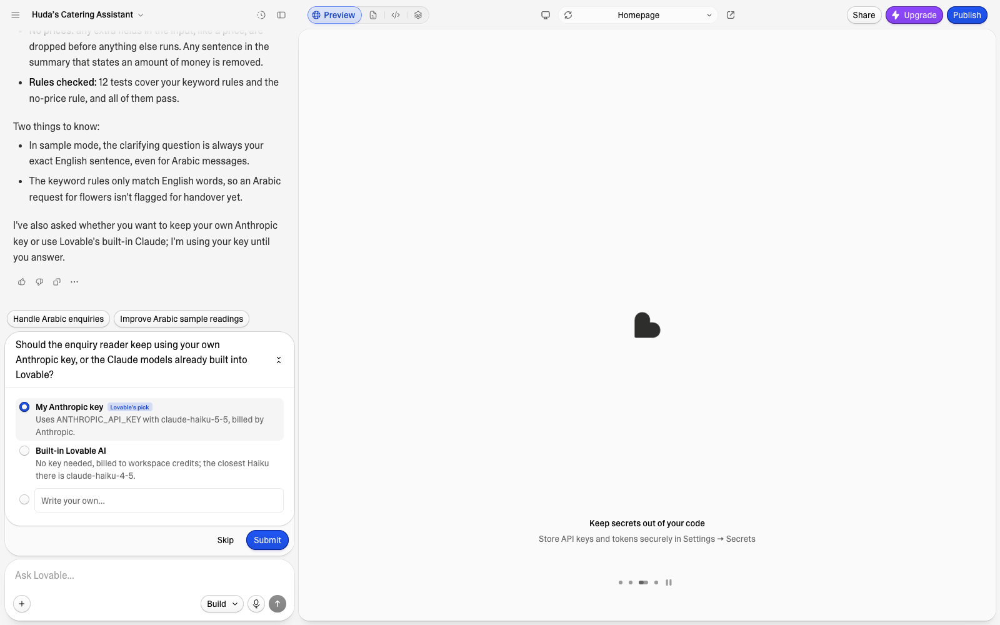
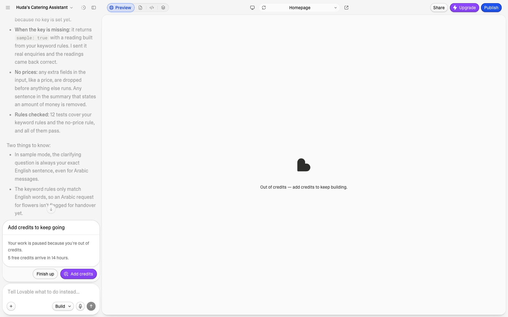
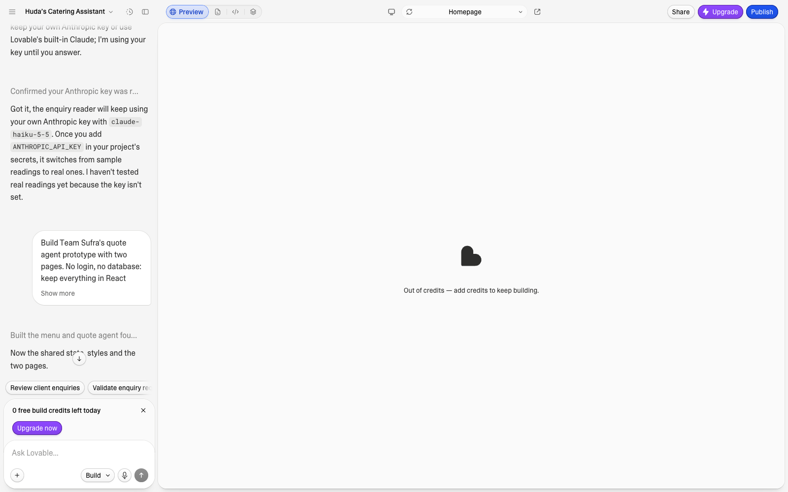

# The Lovable build, in screenshots

*Team Sufra, its users and every figure are fictional.*

## Where the build stands

The build is in progress. Stage 0 is half done: the Lovable account ran out of credits partway through prompt 0.2.

| Prompt | State |
|---|---|
| 0.1, the agent on the server | Done. Gives sample answers with no key; Lovable's own 12 tests pass, including the no-price rule. |
| 0.2, the chat page and the inbox | Half done. The menu file (`src/menu.ts`), the rules, the pricing, the draft format and the shared state are written. The chat page and the inbox aren't built yet, and nothing has been tried in the preview. |
| 1.1 to 4.2 | Not started. |

**One difference from the prompt pack.** Lovable said its new projects can't deploy Edge Functions. It built `read-enquiry` as a server route at `POST /api/read-enquiry` instead, with the same input and output. The key is read only on the server (`process.env.ANTHROPIC_API_KEY`).

**Two choices Lovable made that the prompts don't cover:**
- After a handover, the agent says nothing if the client writes again, because Huda has taken over.
- If `read-enquiry` fails in stage 0, the status becomes *failed* and the client gets no reply. Stage 3 adds the polite reply.

## Stage 0

Prompt 0.1 is built. Lovable asks whether to use your own Anthropic key or its built-in AI. We chose **My Anthropic key**, with `claude-haiku-5-5`, as the pack expects.

Partway through prompt 0.2, the account ran out of credits.

**Finish up** makes Lovable summarize what it wrote and what is left, without building more.

